# CP showcase verification — 20 October 2026

Visual runtime: `2700e9505fdd9a2650ba167f10c6c2333d85710a` (terrain depth/landscape notices), on `f6d3437` (arcade collision), `c0c3df8` (whole-car parking) and `e8dba84` (showcase/fixes).
Baseline: reviewed HUD `d8c8c5b44f820c18e0ba391b2afe6c672182b5a3`.
All remote heads were fetched and compared by commit date/ancestry. The HUD branch
was the newest remote head; main remained at `32d952d`, two commits behind.
The older `codex/ncr-drive-visual-mobile-upgrade` head dated 6 October is a divergent
React implementation, not a newer compatible Three.js gameplay baseline. No
applicable AGENTS.md was present in the checkout or workspace parents.

## What is exercised

Phone acceptance → actual drive/foot modes and obstacle checks → stop/dwell
objectives → atomic version-3 local save → visible reward → reload wallet.
This is a local browser game; there is no game API, server wallet or external DB.

- `npm test`: **85 passed, 0 failed**. Includes dynamic cluster collision, swept
  sliding/head-on contact, independent touch brake, quota-failure/retry, one-shot
  courier completion, story retry throttling, whole-car parking, all three showcase stops and full
  street-lane clearance. Existing region, navigation, recovery, traffic-turn,
  character asset and save tests remain included.
- `npm run lint`: passed. `npm run build`: passed, including its TypeScript and
  `check:production-assets` gate. Existing Vite large-chunk advisory remains.
- Asset validation parsed the committed 1,632,396-byte GLB, found all 21 required
  clips and matched SHA256 `150b3a8c45c74f4a154ddc32405acc8d1d347ce60bbc2aeedf0d84f31e715fab`.
  All three local HUD animations and bundled local WASM were present.
- `tests/showcase-production.mjs`: passed on the production build. It accepts
  jobs through real UI and uses **injected actor placements**, not ordinary travel,
  to test CP/courier quota failures, delayed native-storage retries, single payout,
  saved courier completion and reload, plus driving/walking cluster collisions
  through the normal Game frame. Intentionally missing GLB renders the
  actionable error/reload screen. See `production-fixtures.json`.

## Ordinary input and captures

Ordinary-input run results and measured capture results are attached as JSON
beside this report. `production-smoke.json` passed at runtime `e8dba84` before the parking-only follow-up; it covers ordinary keyboard courier travel,
braking, exit, walking delivery, reload, recovery, settings, touch controls in two
orientations, pointer cancellation and unavailable storage. `ordinary.json` covers
the new CP loop; its telemetry is read-only and its controls are browser keyboard
events. It seeds only a fresh Low-quality career, not actor positions, mission
states or speed. This is distinct from the injected placements in the fixture.

Before/after shots use identical cameras, Balanced quality, DPR 1 and viewports:
1280×720 desktop; 844×390 touch landscape. Three poses: driving, walking, west
junction. These are **controlled CDP placements and static redraws** of unmodified
production bundle bytes, not proof of an ordinary drive. The baseline captures
were taken before visual changes (with the first gameplay fixes already applied;
those fixes do not change the matched static visual poses). Actor animation phases may differ. `tests/showcase-capture.mjs` contains exact placements and cameras.

## Performance evidence and limits

`host.json` identifies the actual 8GB, two-CPU-quota Linux container. Rendering uses
headless Chromium/ANGLE SwiftShader on an AMD EPYC host, not an M1 or a phone.
`after.json` records draw calls, triangles and p50/p95/p99 frame intervals for
reproducible static scenes, with the exact small sample count (10 for each final after scene). These are diagnostic
software-renderer static-redraw measurements, not gameplay/device FPS evidence.
`transfer.json` lists actual production file bytes and reproducible gzip estimates;
wire transfer estimates are not a claim about Vercel compression or mobile startup.
Browser resource timing totals are separately included in the capture measurements; these are session totals including any lazy HUD loads, not a cold-start network budget. The junction recapture skips the already-passed startup input checks and explicitly marks their reused results.

60 FPS on an M1 and 30 FPS on a representative phone remain **unverified targets**.
Real Safari/iOS/Android input, memory, thermal behaviour, sustained frame percentiles
and GPU draw cost still need physical-device acceptance. The original art is a
stylized procedural kit, not photogrammetry or AAA parity. Existing trees and
far-market buildings remain simple; the car and articulated character retain the
reviewed base meshes with steering/gait/grounding improvements.

## Hosted preview

Draft PR: https://github.com/deepdharia/NCR-Drive/pull/12 . No merge or production
promotion was performed. The existing Git integration reported Vercel success for
runtime `e8dba84`, deployment `DCSRi6ucjGvSSxhAD8ZH9vvjjSbh`.
Preview alias: https://ncr-drive-git-feature-cp-showcase-contact-save-deep-07f0.vercel.app .
The alias is mutable; consult the final head's status for its current deployment.

**Hosted gameplay and served-byte identity are not verified.** Curl was rejected
by the workspace proxy before origin access (`CONNECT tunnel failed, response 403`).
Vercel deployment inspection and hosted fetch also returned 403 because the
connection is not authorized for project/team scope `deep-07f0`. No Vercel CLI is
installed as a fallback. Deployment success alone is not live-preview verification.

## Reproduce

Use an available Playwright module and Chromium binary through the existing
`PLAYWRIGHT_MODULE` and `CHROMIUM_EXECUTABLE_PATH` conventions. No browser package
is added to the game's dependencies. Run `npm ci`, `npm test`, `npm run lint`,
`npm run build`, then:

```sh
node tests/production-smoke.mjs
node tests/showcase-production.mjs
node tests/showcase-drive.mjs
TOUCH=1 node tests/showcase-drive.mjs
PHASE=after node tests/showcase-capture.mjs
```

For before captures, build reviewed `d8c8c5b` in a separate checkout, copy the
capture script there and run `PHASE=before`. It uses the same hard-coded poses
and quality while skipping input assertions for the intentionally buggy baseline.
`SHOTS=junction SAMPLES=15` retakes only that pair with 10 measured frames after
5 warmups. Isolate redraw timing from all other browser tests.

## Matched screenshots

[Download the standalone offline comparison viewer](comparison.html) (all images
embedded; no server needed). Camera/viewport/quality parameters are in the capture
script. These are controlled placements, not ordinary-input journey evidence.

| View | Before | After |
| --- | --- | --- |
| desktop driving | 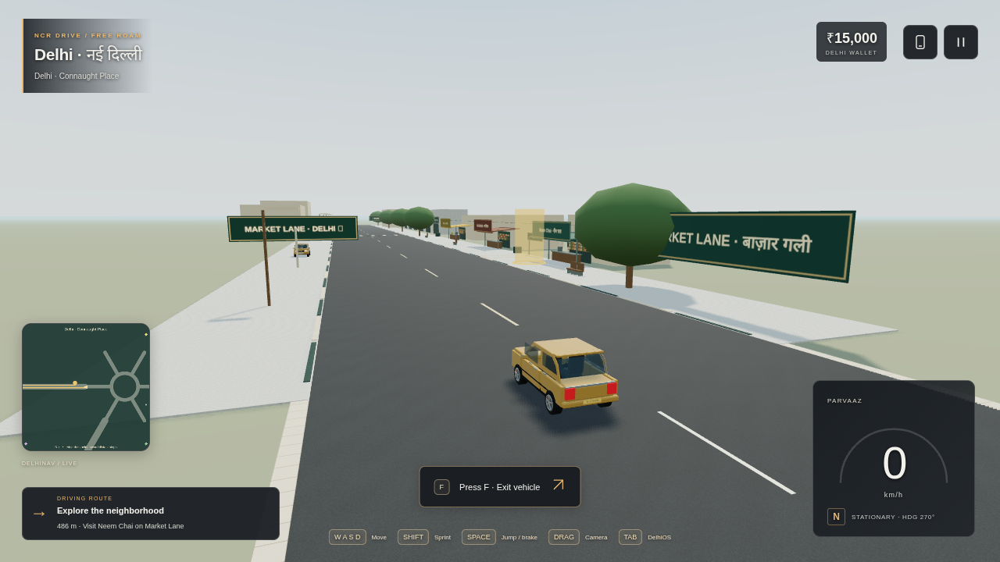 | 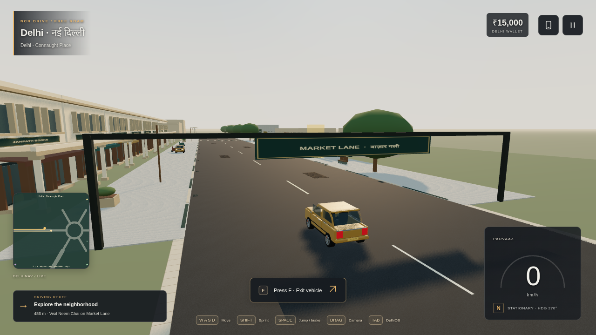 |
| desktop walking | 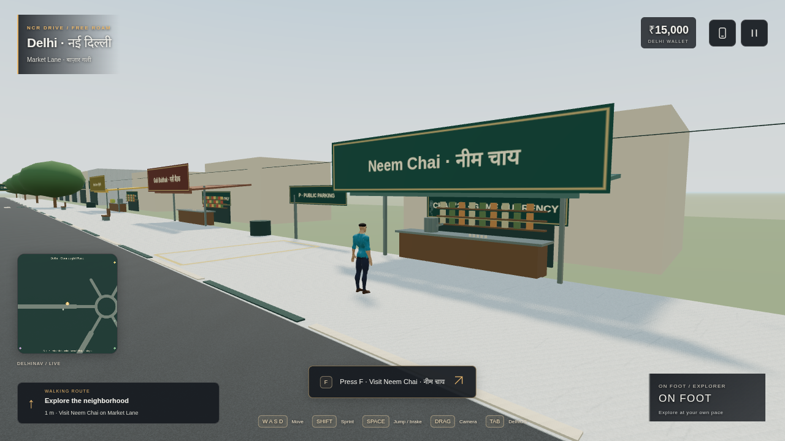 | 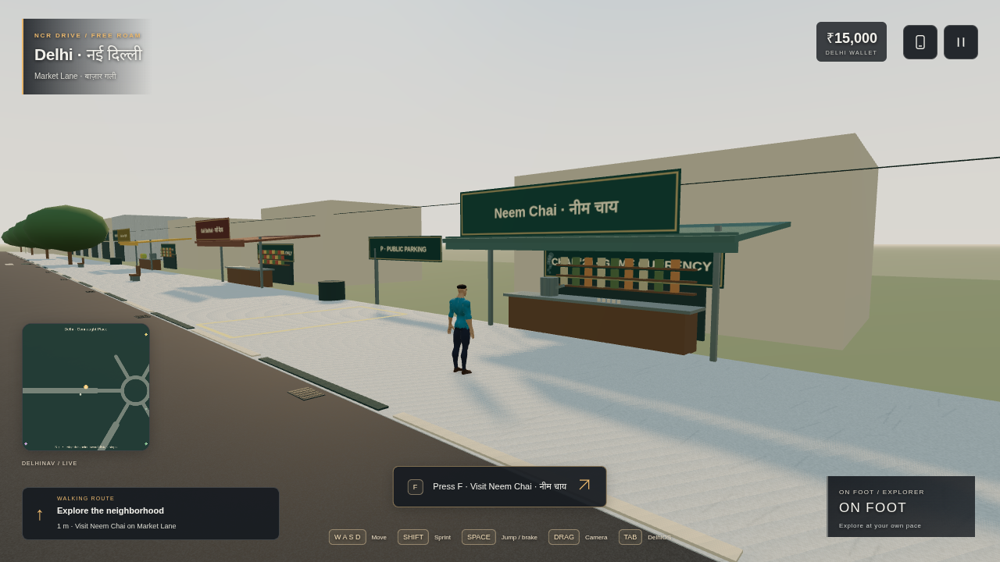 |
| desktop junction | 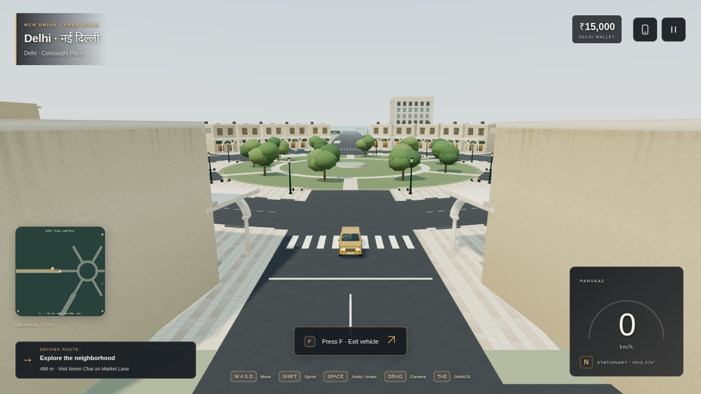 | 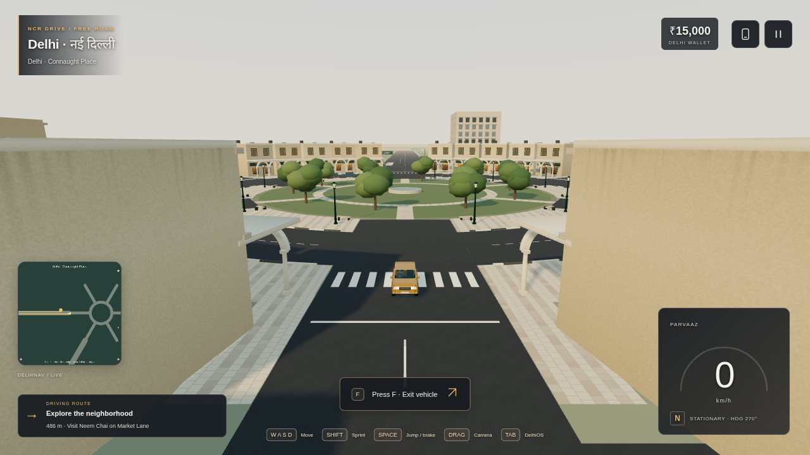 |
| mobile driving | 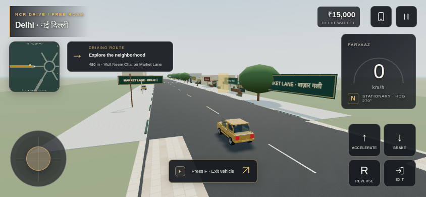 | 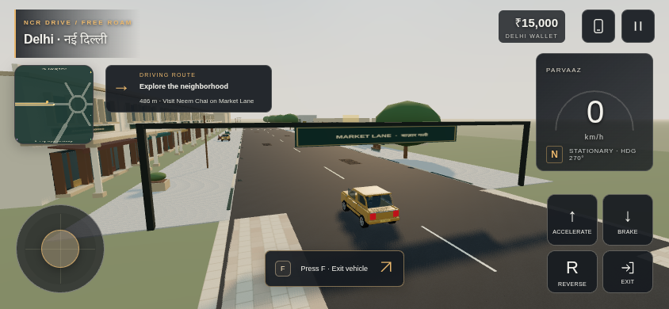 |
| mobile walking | 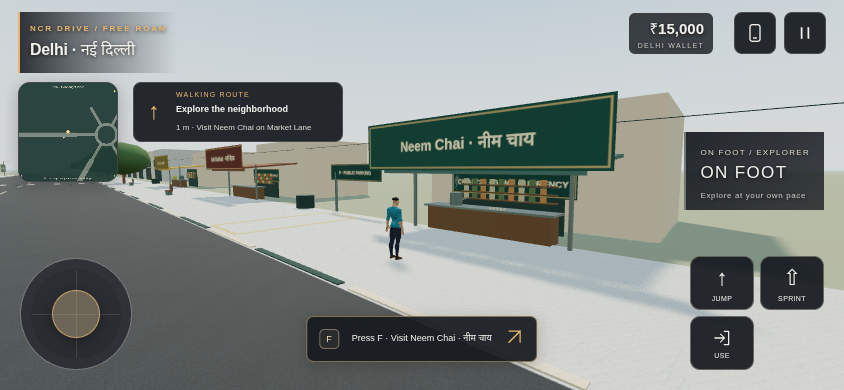 | 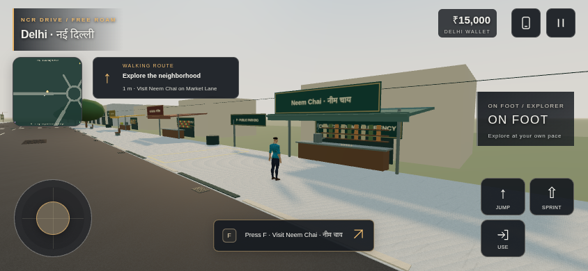 |
| mobile junction | 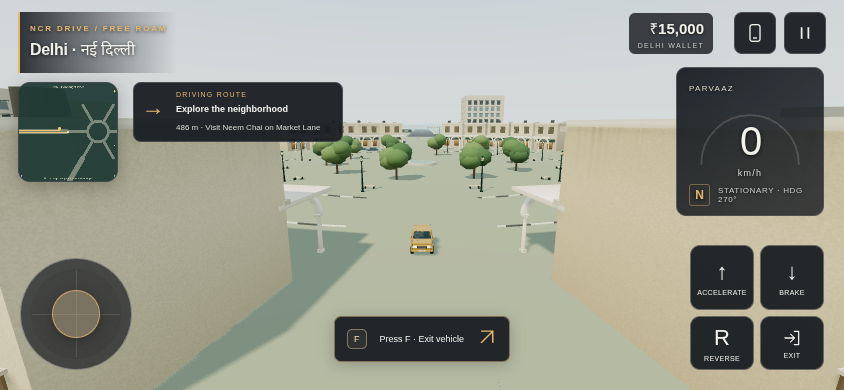 | 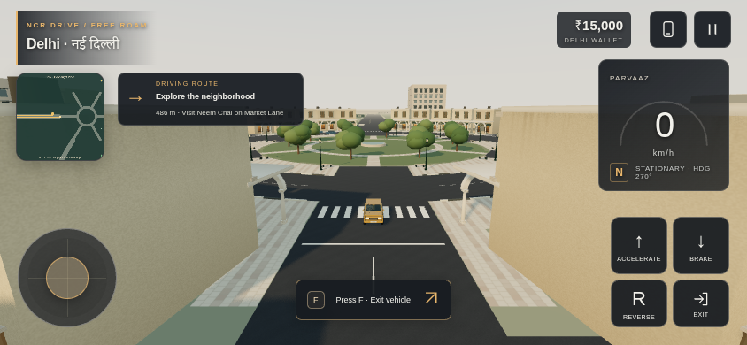 |

## Final static-redraw measurements

All after scenes use 10 samples after 5 warmup redraws. Software rendering, small
samples, no real-device inference. The junction still requires device profiling.

| Scene | Draws | Triangles | p50 / p95 / p99 ms |
| --- | ---: | ---: | --- |
| desktop driving | 513 | 275,355 | 1399.0 / 1535.3 / 1535.3 |
| desktop walking | 415 | 224,099 | 1017.4 / 2078.3 / 2078.3 |
| desktop junction | 627 | 563,996 | 2209.5 / 2487.6 / 2487.6 |
| mobile driving | 517 | 275,403 | 601.9 / 887.8 / 887.8 |
| mobile walking | 414 | 224,019 | 430.9 / 485.4 / 485.4 |
| mobile junction | 628 | 564,008 | 1380.5 / 1459.4 / 1459.4 |
