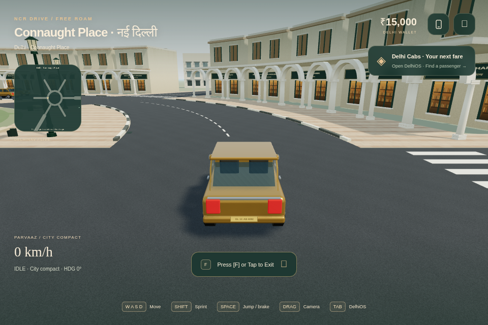
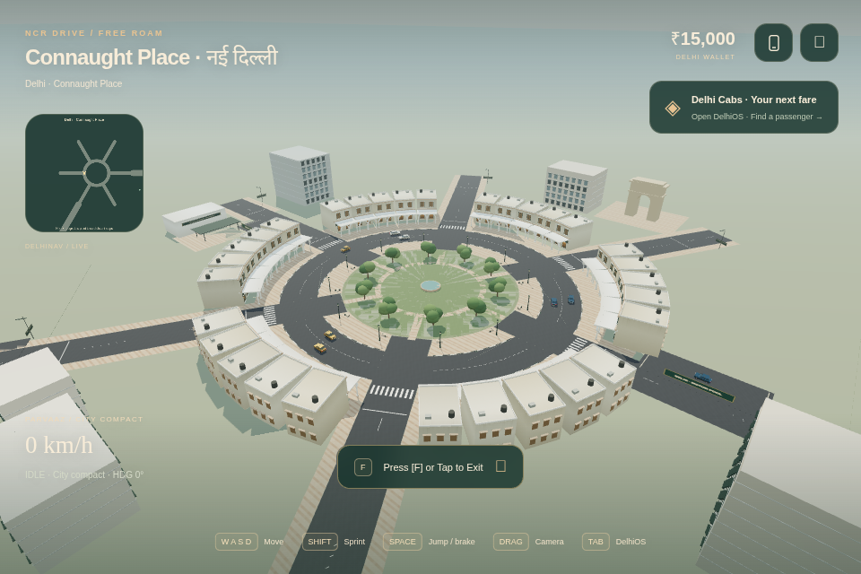
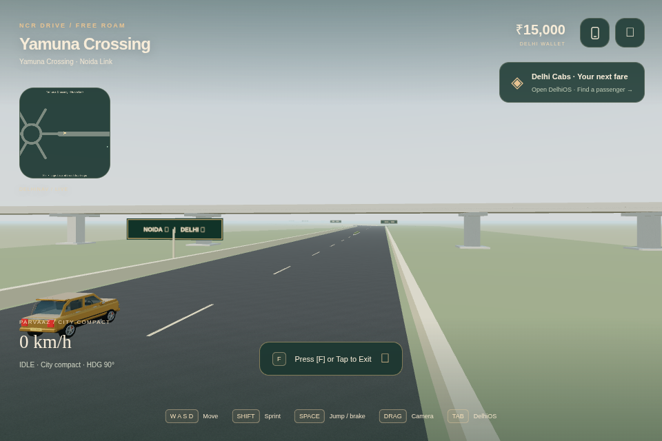

> Historical V1 source/art record. Its UI/schema/test instructions are superseded; use current README/HANDOFF/PLAYTESTS.

# Visual Realism V1

Central Delhi vertical slice on `improve/visual-realism-v1`, based on connected
world `3b5e593d1460dc8aaf8599bf416dbaff5d785f43`. Original fictional geography and
one-metre units remain; this is an incremental realism foundation, not a scanned
or photorealistic Delhi replica. No gameplay topology, vehicle handling, mission
rules or Vercel project/build configuration is replaced.

## Working slice

The CP carriageway is an explicit union: six annular pieces meet six straight
strips at shared edges. There are no overlapping ring/strip faces. The 38–50m
ring and 12m radial widths preserve the existing lane graph, controls and scale.
Crossings have open curb mouths and flush, step-free pavements. Existing 12m
radials retain their full clearance; centre refuges are paint. A planted median
fits the wider east avenue, clear of recovery pads, lane centres and approaches.

Asphalt uses shared deterministic albedo, bump and roughness maps projected in
world metres, including regional box decks, so texture frequency does not stretch
with road length or jump between CP and a corridor. Plaster has restrained dust
and runoff variation; paving has staggered joints; concrete and glass use standard
PBR lighting. Terrain remains flat and reliable. Surface offsets are centimetres
for depth ordering, not new suspension/grounding heights. Curbs end at mouths and
bay openings. Raised walkable terrain and height-map driving remain future work.

Late-morning daylight uses one sun, hemisphere fill, a procedural sky/environment,
ACES exposure 1.0 and distance haze. Three.js 0.186's PCF shadow filter uses radius
2; the bounded shadow camera follows the player in every region. No lantern
point-light pool or full-screen SSAO/bloom/DOF passes compete with driving. This
choice keeps contrast/readability without a new postprocessing dependency.

Existing CP colonnades now have varied plaster, rear glazing/shades, parapets,
water tanks and rooftop service boxes. Additional modular blocks have repeated
window bays and horizontal bands. Original bilingual signs, benches, LED-style
streetlights, planted islands and a supported courier-plaza canopy add local
scale. Existing instanced trees remain stylized geometry, not scanned foliage.
An original ceremonial arch references India's memorial-arch vocabulary at a
fictional compressed location; it is not an accurate India Gate model.

The east approach has a supported **scenic flyover**, 11m × 184m, deck underside
6.4m, with piers/caps, abutments, upper barriers and closed ends. Its ground
underpass is usable in both directions. **There are no accessible elevated
ramps or elevated driving.** Current vehicle grounding is flat; this increment
does not pretend a scenery deck is a new traversable road. Elevated routing,
surface-height grounding and collision layers need a separate tested increment.

Vehicle coachwork scales to each existing spec while 0.32m tires remain round
and grounded. Steering, wheel travel, stationary brake calipers, brake emissive
response and restrained body lean/heave animate independently. Estate roof rails
and the sport lower lip distinguish variants without real-world branding. The
roster still shares a procedural base body. Chase view adds small speed-based
look-ahead, radius and FOV changes; existing orbit/occlusion and handling remain.

## Render budgets and persistence

Use the pause-menu Graphics button to cycle Balanced → Low → High → Balanced.
Old Performance saves map to Low; old Detailed/default saves map to Balanced.
The optional validated `graphicsQuality` field stays inside schema v2, with the
legacy boolean maintained. Existing migration, backups, unknown-version,
corruption and storage-failure policies remain. No active-job resume is added.

| Preset | DPR cap desktop | Sun map | Detailed cars within | Outer scenery margin |
| --- | ---: | ---: | ---: | ---: |
| Low (Performance) | 0.75 | off | 40m | 400m |
| Balanced | 1.25 | 1024² | 90m | 550m |
| High (Detailed) | 1.5 | 2048² | 160m | 700m |

Coarse-pointer DPR is capped at 1.25; device DPR is never exceeded. Distant cars
use a two-mesh proxy; physics/traffic population never depend on quality. Original
world chunks/instances remain. New road faces are merged; repeated facades,
curbs, furniture and service details are instanced. Secondary slice detail uses
an extent-aware distance budget. CP activates through 850m, new slice through
950m, so approach silhouettes emerge through haze rather than vanishing nearby.
Colliders stay globally indexed and independent of visibility.

All scene materials, textures and geometries remain owned by Game's disposal
path, including hidden LODs. Two complete enabled-preset shadow targets are
cached (1024² and 2048²) to avoid r186 depth-attachment replacement hazards;
both are freed on shutdown. The environment is explicitly prefiltered once,
its generator scratch data is disposed, and Game destroys its owned WebGL
context on unmount. Three.js retains a module-global DFG_LUT info counter of
one after disposal; it is not an owned-scene leak or a growing-cycle count.
No new runtime dependencies, network assets or paid services are used.

## Verification and limits

`npm test`, `npm run lint`, `npm run build`, `npm run test:production`,
`npm run test:regional-wiring`, `npm run test:visual` are the review gates.
`tests/visual-realism.test.ts` covers rendered ring/strip coverage without face
overlaps, all-roster seam/underpass clearance, regional job/return routes against
new architecture, v2 quality round-trips and bounded camera behaviour. Existing
route, migration, recovery, traffic and reward tests remain.

The visual browser harness explicitly intercepts a development module and places
actors/cameras. It checks representative CP/corridor/outer scenes, wheel contact,
three warmed regional/preset cycles, quality reload and full resource disposal.
Its short fixed-scene software-renderer samples are diagnostic only. Production
smoke uses the shipped dist and ordinary inputs for original jobs/controls/touch;
controlled regional wiring is separate from full physical route drives.

Actual results, bundle/commit, software sample numbers and deployment status are
recorded in HANDOFF.md / PLAYTESTS.md and the visual evidence JSON. Do not infer
M1 desktop 60 FPS, Android 30 FPS, physical GPU frame times or enjoyment from
SwiftShader. Owner device benchmarking must name browser/device, viewport/DPR,
preset, route, warmup/sample duration, p50/p95 and memory/resource trends. Repeat
CP→east underpass→Yamuna→Noida→CP and CP→Gurgaon→CP, inspect all seam mouths,
then repeat three times for hitches/retention. Test both phone orientations,
simultaneous touches, focus loss, vehicle switching and reward/settings reload.

## Review views

These are controlled development camera/actor placements, not evidence that a
whole journey was driven. Images are screenshots of original project geometry;
they are documentation only and are not bundled into the game.

